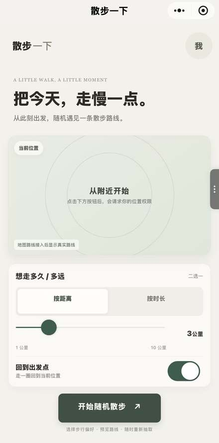
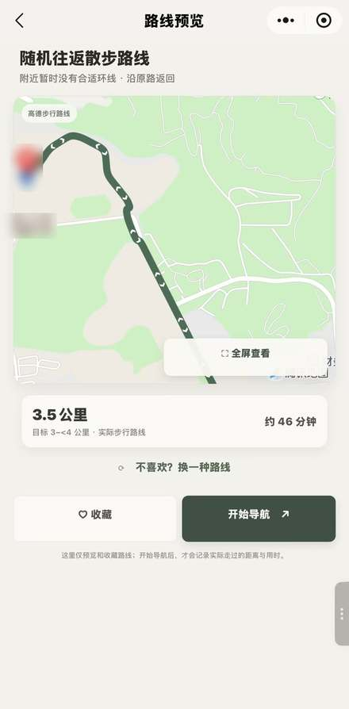
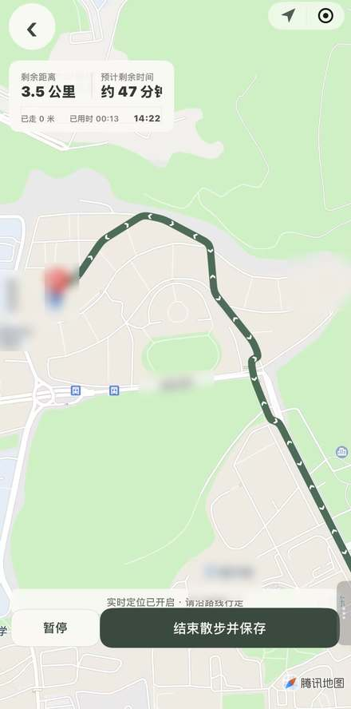

# 散步一下

一个帮助用户从当前位置生成散步路线、记录真实步行过程的微信小程序。

## 项目截图

以下截图展示首页、路线预览和实时导航。

<table>
  <tr>
    <td align="center"> 首页</td>
    <td align="center"> 路线预览</td>
    <td align="center"> 实时导航</td>
  </tr>
</table>

## 功能

- 按距离或时长生成随机步行路线，可选择走回出发点。
- 预览路线、重新抽取路线并收藏喜欢的路线。
- 实时定位导航；偏离路线时规划接回原路线前方的步行路线。
- 支持暂停、继续和提前结束；散步记录按实际 GPS 距离和有效时长保存。
- 使用云开发保存个人资料与散步记录。

## 项目结构

- `miniprogram/`：微信小程序代码
- `miniprogram/cloudfunctions/walkData/`：散步记录云函数
- `demo/`：浏览器交互原型
- `项目说明.md`：产品想法、功能范围和进度

## 开发环境配置

1. 在微信开发者工具中导入 `miniprogram/` 目录。
2. 将 `miniprogram/utils/amap-config.example.js` 复制为 `amap-config.js`，填入高德开放平台的微信小程序 Key。
3. 在微信公众平台服务器域名的 `request` 合法域名中添加 `https://restapi.amap.com`。
4. 配置并部署 `walkData` 云函数，确保小程序连接到正确的云开发环境。

本地高德 Key 和微信开发者工具私有配置已加入 `.gitignore`，不会提交到仓库。

> 实时定位与偏航重规划效果依赖手机定位权限、网络及地图服务；发布前请在真机上完成路线、保存和后台定位验收。
